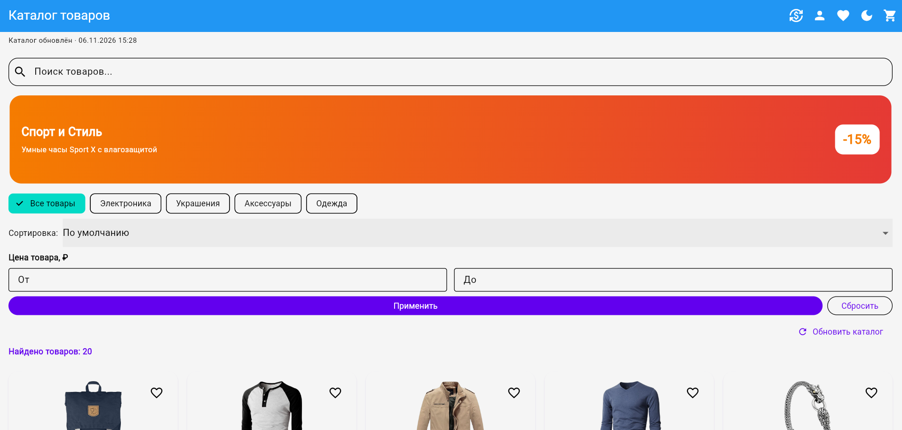
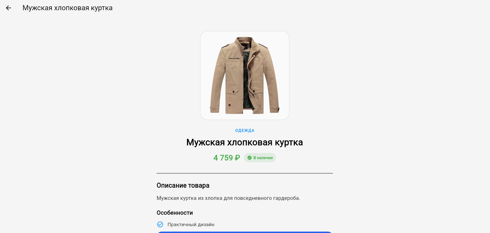
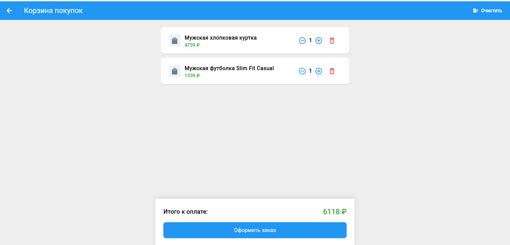
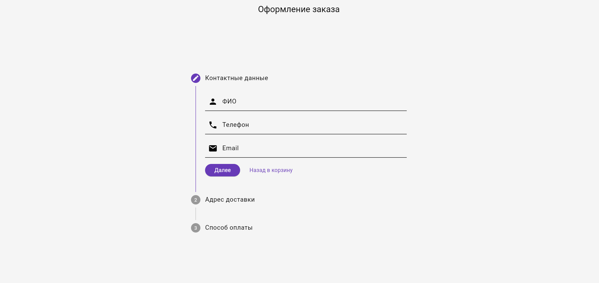
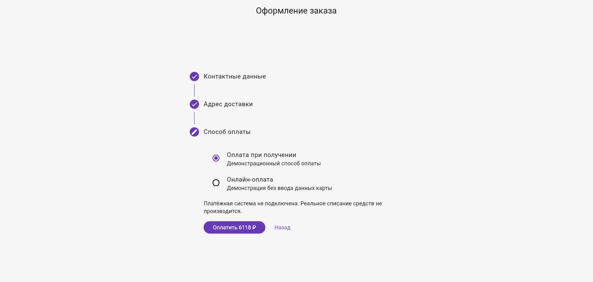
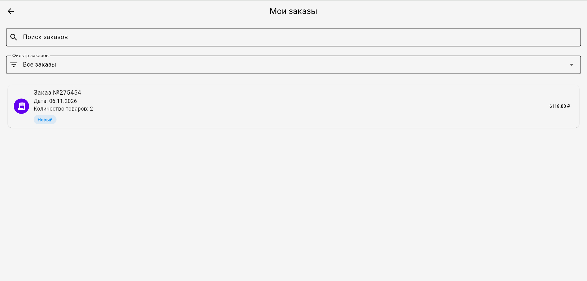
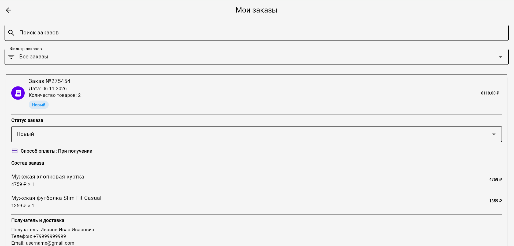
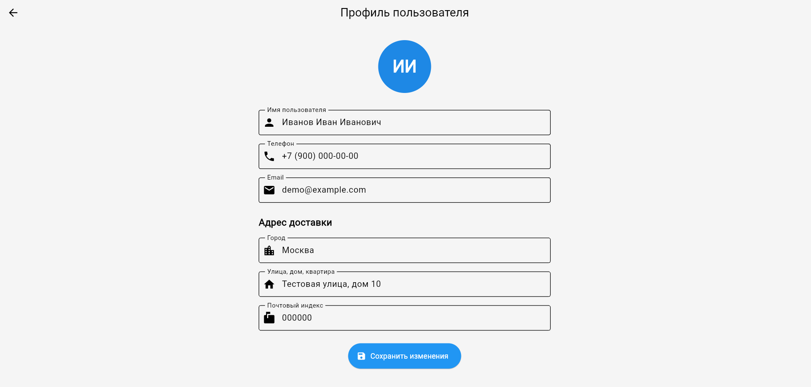

# ShopFlow — Flutter E-commerce Application

A responsive e-commerce demo application built with Flutter and Dart. ShopFlow demonstrates a complete shopping experience, including product browsing, search, filtering, cart management, checkout, order history, and customer profiles.

**Live Demo:** https://disso0.github.io/shopflow-flutter/

**GitHub Repository:** https://github.com/disso0/shopflow-flutter

---

## Screenshots

### Product Catalog

Browse products, search by name, filter by category and price, and sort the catalog.



### Product Details

View product images, descriptions, prices, categories, and availability.



### Shopping Cart

Manage cart items, update quantities, remove products, and calculate the total amount.



### Checkout

A multi-step checkout flow with customer contact details, delivery address, and payment method selection.





### Order History

Search and filter previous orders, view order dates, totals, item counts, and statuses.



### Order Details

Review order contents, payment method, customer information, delivery details, and update order status.



### Customer Profile

Edit and save customer information and delivery address.



---

## Features

- Product catalog with product cards and detailed product pages.
- Product search.
- Category and price filtering.
- Product sorting.
- Shopping cart with quantity management.
- Automatic cart total calculation.
- Favorites with local persistence.
- Multi-step checkout process.
- Customer contact and delivery information.
- Demonstration payment methods.
- Order history and order details.
- Order search and status filtering.
- Order status management.
- Customer profile editing.
- Currency settings.
- Light and dark themes.
- Responsive user interface for desktop and mobile screens.
- Local data persistence.

## Tech Stack

| Technology | Purpose |
|---|---|
| Flutter | UI development |
| Dart | Application programming language |
| Provider | State management |
| GoRouter | Navigation and routing |
| SharedPreferences | Local data persistence |

## Architecture

The application separates its main responsibilities into several layers:

- `data` — models and repositories.
- `domain` — application state and providers.
- `presentation` — screens and UI components.

## Testing and Code Quality

The project includes automated tests covering application functionality, repositories, state management, order processing, and data persistence.

Latest verified results:

- `flutter analyze` — no issues found.
- `flutter test` — 68 tests passed.

## Getting Started

### Requirements

- Flutter SDK
- Dart SDK
- Android Studio or Visual Studio Code

### Installation

Clone the repository:

```bash
git clone https://github.com/disso0/shopflow-flutter.git
cd shopflow-flutter
```

Install dependencies:

```bash
flutter pub get
```

Run the application in Chrome:

```bash
flutter run -d chrome
```

Run automated tests:

```bash
flutter test
```

Analyze the project:

```bash
flutter analyze
```

## Demo Payment Notice

ShopFlow is a portfolio demonstration project.

Checkout and payment processing are simulated. No real payment provider is connected, and no real financial transactions are performed.

## Project Status

ShopFlow demonstrates Flutter UI development, state management, local persistence, responsive layouts, and e-commerce workflow implementation.

The application currently uses local storage and demonstration data. Backend integration and production payment processing are not included.

## Author

**disso0**

Flutter Developer

[GitHub Profile](https://github.com/disso0)

Open to freelance projects and collaboration.